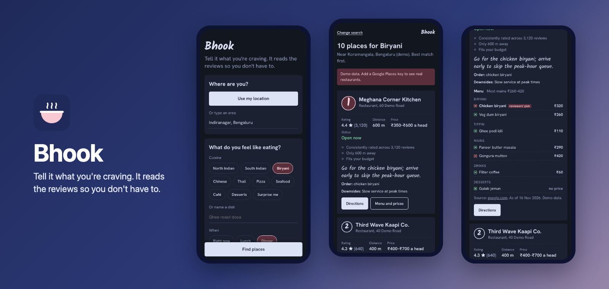
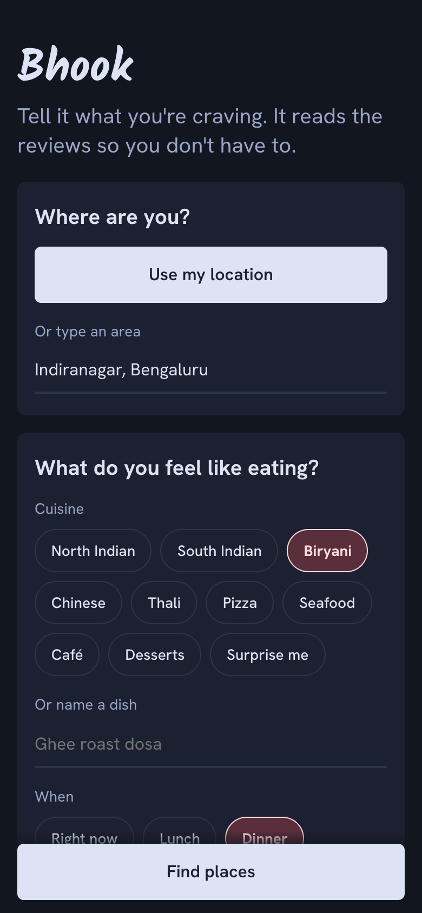
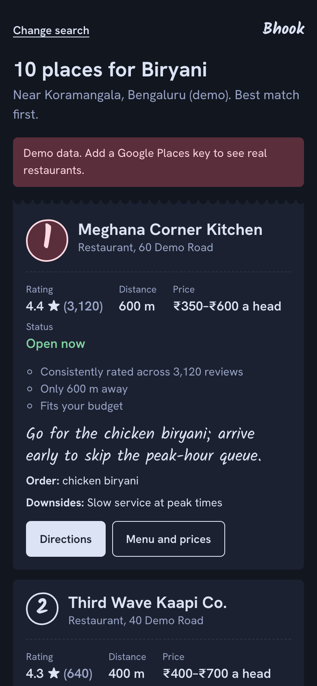
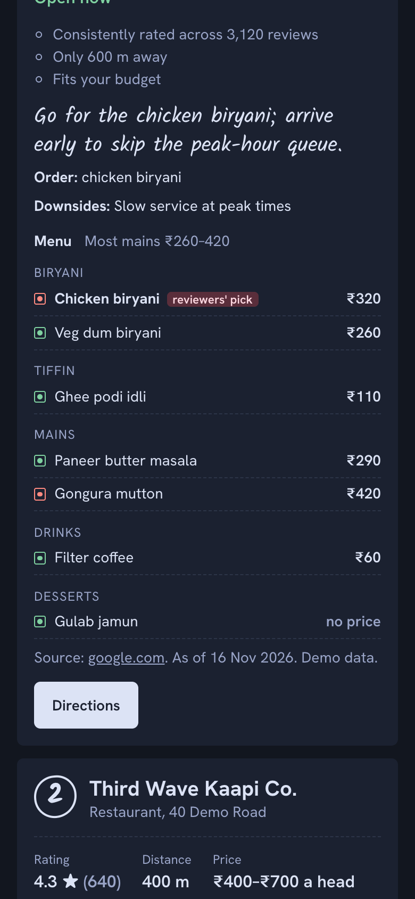
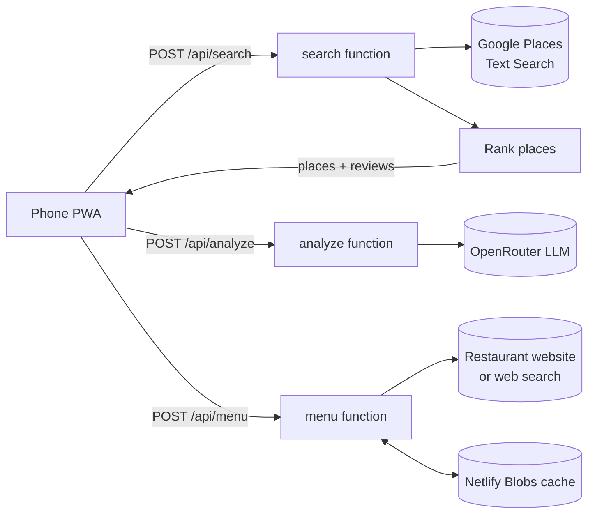

<div align="center">


# Bhook

**Tell it what you're craving. It reads the reviews so you don't have to.**

A phone-first web app that finds nearby restaurants, ranks them by what reviewers actually say, and tells you what to order and what to watch out for.

[](https://github.com/PrataapMS/bhook/actions/workflows/ci.yml)
[](https://github.com/PrataapMS/bhook/actions/workflows/codeql.yml)
[](LICENSE)


[Features](#features) · [Quick start](#quick-start) · [How it works](#how-it-works) · [Deploy](#deploy) · [Roadmap](docs/ROADMAP.md) · [Contributing](CONTRIBUTING.md)



</div>

## Why Bhook?

Map apps show you a star rating and 2,000 reviews. Bhook answers the question you actually have at lunch: *where should I go right now, and what should I order there?*

- Pick a craving, a budget and a distance. Get a short, ranked list instead of an endless map.
- Each place comes with a one-line verdict, the dishes reviewers rave about, honest downsides and red flags.
- Menus and prices load on demand, with the source and date shown.

Built for India first: prices in ₹, veg and non-veg markers, local cuisines and budget bands.

## Features

| | |
|---|---|
| 📍 **Near you** | Use your location or type an area. Choose distance, meal, budget and diet. |
| 🏆 **Smarter ranking** | Bayesian rating (so 4.9 from 12 reviews doesn't beat 4.4 from 3,000), relevance, distance, budget fit and review sentiment. |
| 🧠 **Review summaries** | An LLM reads recent reviews and returns a verdict, what to order, downsides, red flags and whether the place is getting worse. |
| 🍛 **Menus and prices** | Fetched on tap from the restaurant's own site, with a web-search fallback. Every price shows where it came from. |
| 🔁 **Re-rank with insights** | Once summaries arrive, re-order the list by what reviewers actually said. Never reshuffled behind your back. |
| 📱 **Installable PWA** | Add to your home screen on Android or iPhone. Fast, app-like, no store needed. |
| 🧪 **Demo mode** | Runs fully on generated data with no API keys, so you can try it in minutes. |
| 🔒 **Keys stay server-side** | All API keys live in serverless functions, never in the browser. |

<table>
  <tr>
    <td align="center"><br><sub>Say what you're craving</sub></td>
    <td align="center"><br><sub>Ranked, with a verdict</sub></td>
    <td align="center"><br><sub>Menu and prices, sourced</sub></td>
  </tr>
</table>

<sub>Screenshots use demo data.</sub>

## Quick start

You need **Node 24** (see [`.nvmrc`](.nvmrc)). No API keys are required to try it.

```bash
git clone https://github.com/PrataapMS/bhook.git
cd bhook
nvm use
npm install
cp .env.example .env
npm run dev          # http://localhost:8888 (UI + API together)
```

The app shows a "Demo data" notice until you add keys. To use real data, follow [docs/SETUP.md](docs/SETUP.md), add your keys to `.env`, then:

```bash
npm run check:keys   # verifies Google + OpenRouter keys at zero cost
```

> Use port 8888, not Vite's 5173. Plain `vite` has no `/api/*` routes.

### Install on your phone

- **Android (Chrome):** open the site, menu, **Install app**.
- **iPhone (Safari):** Share, **Add to Home Screen**.
- Location needs HTTPS, so use a deployed site (or type an area when testing locally).

## Configuration

All settings are environment variables, read only on the server. Any empty key switches that service to demo data.

| Variable | Required | Default | Purpose |
|---|---|---|---|
| `GOOGLE_PLACES_API_KEY` | For real places | empty (demo) | Google Places API (New) key |
| `OPENROUTER_API_KEY` | For real summaries | empty (demo) | [OpenRouter](https://openrouter.ai) key |
| `OPENROUTER_MODEL_REVIEWS` | No | `anthropic/claude-haiku-4.5` | Default model for summaries |
| `OPENROUTER_ALLOWED_MODELS` | No | default only | Models the in-app picker may use |
| `USE_MOCKS` | No | `false` | Force demo data even with keys |

> [!WARNING]
> Never put a key in a `VITE_`-prefixed variable. Those are bundled into the browser.

## How it works

Bhook is a deterministic pipeline, not a chatbot. The LLM only does narrow jobs (summarising reviews, extracting menus), which keeps it fast, cheap and easy to debug.



## Tech stack

- **UI:** React 19, TypeScript, Vite, plain CSS, `vite-plugin-pwa`
- **API:** Netlify Functions (Node 24), Netlify Blobs
- **Data:** Google Places API (New), OpenRouter (any supported model)
- **Quality:** Vitest, strict TypeScript, GitHub Actions CI, CodeQL, Dependabot

## Scripts

| Command | What it does |
|---|---|
| `npm run dev` | UI and functions on port 8888, loads `.env` |
| `npm test` | Unit tests (Vitest) |
| `npm run typecheck` | TypeScript across UI, server and functions |
| `npm run build` | Production build into `dist/` (PWA manifest and service worker) |
| `npm run check:keys` | Free checks that your keys work and models exist |

## Project layout

```
src/                 React PWA. App.tsx holds the flow; components/ the building blocks.
shared/              Types and ranking used by both UI and server.
server/              Server-only code: Google and OpenRouter clients, menus, env, demo data.
netlify/functions/   HTTP endpoints: /api/search, /api/analyze, /api/menu, /api/health
scripts/             Key checker and README screenshot generator.
docs/                Setup guide, roadmap, maintainer notes.
```

## Deploy

Bhook runs on Netlify (static UI and serverless functions in one site). Production deploys are deliberate:

- Deploys run from GitHub Actions only, when the **major version** in `package.json` changes (or on a manual run).
- Every deploy waits for approval on the `production` environment.
- Netlify's own Git-triggered builds are switched off in [`netlify.toml`](netlify.toml).

To host your own copy, see [docs/SETUP.md](docs/SETUP.md).

## Costs and limits

Bhook is designed to run on free tiers for personal use. Each search is one Google Places call, review summaries are one small LLM call per place, and menus are fetched only when you tap. Set a daily quota on your Google key and a credit limit on your OpenRouter key; [SETUP](docs/SETUP.md) walks through both.

## Roadmap

See [docs/ROADMAP.md](docs/ROADMAP.md) and the [project board](https://github.com/users/PrataapMS/projects/4). Next up: personalisation (remember how your visits went) and polish (lunch-time nudge, share a pick, offline results).

## Contributing

Issues and pull requests are welcome. Read [CONTRIBUTING.md](CONTRIBUTING.md) first. For security issues, see [SECURITY.md](SECURITY.md).

## Acknowledgements and disclaimer

Places data comes from [Google Maps Platform](https://developers.google.com/maps). Review summaries and menus are AI-generated and can be wrong; always check the linked source. Bhook is not affiliated with Google or any restaurant.

## License

[MIT](LICENSE) © 2026 PrataapMS
